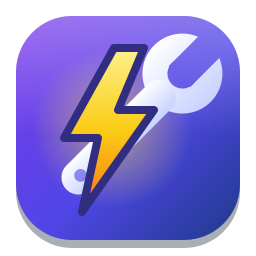

<div align="center">



# Voltkit

[English](README.md) · **Español** · [Deutsch](README.de.md) · [Français](README.fr.md) · [简体中文](README.zh-CN.md)

**Herramientas potentes para tu escritorio Linux.**
OCR de pantalla, un lector de códigos QR, un selector de color, una regla de pantalla, un compresor de imágenes y
videos, un expansor de texto, Pegado inteligente, Mantener activo, un editor de hosts y entorno, un buscador de
“¿qué lo está usando?”, un administrador de permisos de apps, un diagnóstico de suspensión, un informe del sistema,
un detective de atajos y un ajuste de GPU, en una sola app.

[](https://github.com/arios4k/voltkit/releases/latest)
[](https://github.com/arios4k/voltkit/actions/workflows/ci.yml)
[](https://arios4k.github.io/voltkit/manual/)
[](LICENSE)
[](#instalación-ubuntu-debian-y-derivadas)
[](#instalación-fedora)
[](https://www.rust-lang.org)
[](https://paypal.me/AlexisRios)

<picture>
  <source media="(prefers-color-scheme: dark)" srcset="docs/screenshots/color-dark.png?v=0.11.0">
  
</picture>

</div>

> Voltkit está disponible en español, inglés, alemán, francés y chino simplificado, y usa el idioma de tu sistema automáticamente: la app,
> la línea de comandos y las páginas del manual (`man voltkit`). Las capturas de esta página son de la versión
> en inglés.

## Una app en lugar de dieciocho

Tener estas herramientas básicas en Linux suele significar buscar un applet distinto para cada tarea, cada uno con
su propio aspecto, ajustes y atajos. Voltkit las reúne en una app GTK4 nativa con un solo conjunto de atajos:

| En lugar de… | Voltkit te da | Atajo |
|---|---|---|
| nada: no había una pantalla para esto | **Permisos de apps**: cambia u olvida las respuestas que diste a las apps que pidieron capturas de pantalla, la cámara, tu ubicación y más | — |
| un compresor de imágenes aparte, más conjuros de ffmpeg | **Compresor de archivos**: suelta archivos PNG, JPEG, WebP o MP4 para quitarles los metadatos y reducir su tamaño | arrastrar y soltar |
| un selector de color aparte | **Selector de color**: un cuentagotas para cualquier píxel, HEX/RGB/HSL, revisión de contraste WCAG e historial | <kbd>Super</kbd>+<kbd>Mayús</kbd>+<kbd>C</kbd> |
| bucles de shell con `mv` o un renombrador aparte | **Renombrar en lote**: renombra muchos archivos a la vez con buscar y reemplazar, expresiones regulares y numeración, con vista previa y deshacer | — |
| un redimensionador de imágenes aparte | **Redimensionar imágenes**: cambia el tamaño de muchas imágenes a la vez, conservando su forma y sin tocar los originales | — |
| una herramienta aparte para ajustar la GPU, más utilidades de cada fabricante | **Ajuste de GPU**: monitorea tarjetas gráficas NVIDIA, AMD e Intel y cambia límites de potencia, ventiladores y curvas de ventilador, temperaturas objetivo, frecuencias y voltaje, con cada cambio en vista previa y deshecho si no lo confirmas | — |
| editar `/etc/hosts` y `~/.profile` en una terminal | **Hosts y entorno**: activa y desactiva entradas de hosts y administra las variables de entorno de tu sesión | — |
| una extensión del shell para mantener la pantalla encendida | **Mantener activo**: evita que tu computadora se suspenda o se bloquee de 30 minutos a 4 horas, o hasta que lo apagues | — |
| un lápiz de presentación aparte | **Zoom y anotaciones**: congela la pantalla, acércala y dibuja sobre ella con lápiz, flechas, recuadros y texto | <kbd>Super</kbd>+<kbd>Shift</kbd>+<kbd>Z</kbd> |
| un lector QR en tu teléfono o una página web de QR | **Código QR**: lee un código QR en cualquier parte de la pantalla, o convierte texto, enlaces y datos de Wi-Fi en uno | <kbd>Super</kbd>+<kbd>Mayús</kbd>+<kbd>Q</kbd> |
| una regla de pantalla aparte, o capturas y un editor de imágenes | **Regla de pantalla**: congela la pantalla y mide lo que sea en píxeles | <kbd>Super</kbd>+<kbd>Mayús</kbd>+<kbd>R</kbd> |
| adivinar por qué un atajo de teclado no hace nada | **Detective de atajos**: presiona cualquier atajo para ver a quién pertenece, encontrar conflictos, elegir una combinación libre y cambiarlo | — |
| convertidores en línea para JSON, tablas y mayúsculas | **Pegado inteligente**: pega el portapapeles convertido: JSON ordenado, una tabla de hoja de cálculo como Markdown, un enlace sin rastreo, texto de un PDF sin líneas cortadas, o el texto de una imagen copiada | <kbd>Super</kbd>+<kbd>Mayús</kbd>+<kbd>V</kbd> |
| un montón de comandos de terminal para responder “¿qué hardware tengo?” | **Informe del sistema**: tu hardware explicado, con revisiones y soluciones de drivers y de salud de las unidades, temperaturas, actualizaciones de firmware, ampliaciones de memoria, qué cambió desde una actualización y un informe seguro para compartir | — |
| un expansor de texto aparte | **Expansión de texto**: un selector de fragmentos con búsqueda, y disparadores opcionales al escribir como `;date` | <kbd>Super</kbd>+<kbd>Mayús</kbd>+<kbd>E</kbd> |
| una app de OCR aparte | **Extractor de texto**: arrastra un recuadro alrededor de cualquier texto en pantalla, incluso en videos e imágenes, y llega a tu portapapeles | <kbd>Super</kbd>+<kbd>Mayús</kbd>+<kbd>T</kbd> |
| `lsof`, `fuser` y `ss` en una terminal | **¿Qué lo está usando?**: mira qué apps mantienen ocupado un archivo, una carpeta, una unidad o un puerto, y ciérralas | — |
| buscar en los registros del sistema en una terminal | **¿Por qué no se suspendió?**: mira qué mantiene activa la computadora, qué la despertó y cuánta batería usó mientras estaba suspendida | — |

## Manual

**Para aprender a usar Voltkit, lee el [manual de Voltkit](https://arios4k.github.io/voltkit/manual/)** (en inglés). Explica cada herramienta paso a paso, con los atajos de teclado, el uso desde la línea de comandos, la configuración y la solución de problemas. También se abre desde la app con **F1** o con **Ayuda y manual** en el menú.

## Por qué Voltkit

- **Hecho para Wayland.** Usa los portales del propio escritorio para capturas, el cuentagotas y el pegado, así
  que no hay trucos de X11 ni extensiones del shell.
- **Privado por diseño.** Todo funciona localmente, sin acceso a la red y sin telemetría. Los disparadores al
  escribir solo guardan en memoria los últimos caracteres y nunca registran ni guardan lo que escribes.
- **Pequeño y nativo.** Un solo binario de 4 MB (un paquete de 1.4 MB), GTK4 + libadwaita, modo claro y oscuro.
- **Programable.** Cada función también es un comando (`voltkit ocr`, `voltkit color '#3584e4'`,
  `voltkit compress *.jpg`), con páginas del manual para todos.
- **Se revisa solo.** `voltkit doctor` te dice exactamente qué falta y el comando para instalarlo.
- **Paquetes firmados.** Instala y actualiza con apt desde un repositorio firmado con GPG.
- **En tu idioma.** Español, inglés, alemán, francés y chino simplificado, según el idioma de tu sistema.

Voltkit se desarrolla y prueba en GNOME (Zorin OS 18). Usa portales XDG estándar, así que KDE Plasma y otros escritorios también deberían funcionar; los reportes son bienvenidos. Hay más respuestas en las [preguntas frecuentes](https://arios4k.github.io/voltkit/manual/faq.html) del manual.

<sub>Capturas tomadas en Zorin OS 18 con las paletas clara y oscura de Voltkit. Se regeneran con
`docs/screenshots/capture.sh` (o `docs/screenshots/capture.sh es` para la app en español; también `de`, `fr` y `zh_CN`).</sub>

## Instalación (Ubuntu, Debian y derivadas)

Para Ubuntu 24.04+, Debian 13+, Linux Mint 22, Zorin OS 18, Pop!_OS 24.04 y otras derivadas en Intel/AMD de 64 bits:

```bash
sudo curl -fsSLo /usr/share/keyrings/voltkit-archive-keyring.gpg \
  https://arios4k.github.io/voltkit/voltkit-archive-keyring.gpg
echo "deb [signed-by=/usr/share/keyrings/voltkit-archive-keyring.gpg] https://arios4k.github.io/voltkit stable main" \
  | sudo tee /etc/apt/sources.list.d/voltkit.list
sudo apt update && sudo apt install voltkit
```

apt instala las herramientas necesarias (Tesseract, wl-clipboard, el portal del escritorio) junto con Voltkit, y
las actualizaciones llegan con `sudo apt upgrade`.

Luego abre Voltkit desde tus apps: configura solo su servicio en segundo plano y sus atajos de teclado. Consulta [Install](https://arios4k.github.io/voltkit/manual/install.html) y [A tour of the app](https://arios4k.github.io/voltkit/manual/tour.html) en el manual para saber qué hacer después.

## Instalación (Fedora)

Para Fedora 43 y posteriores en Intel/AMD de 64 bits, desde el [repositorio COPR](https://copr.fedorainfracloud.org/coprs/arios/voltkit/):

```bash
sudo dnf copr enable arios/voltkit
sudo dnf install voltkit
```

Luego abre Voltkit desde tus apps; se configura solo de la misma forma. Las actualizaciones llegan con
`sudo dnf upgrade`.

## Instalación (desde el código fuente)

Requisitos: Rust 1.85+, GTK ≥ 4.14, libadwaita ≥ 1.5.

```bash
# Debian/Ubuntu
sudo apt install libgtk-4-dev libadwaita-1-dev
# Fedora
sudo dnf install gtk4-devel libadwaita-devel
# Arch
sudo pacman -S gtk4 libadwaita
```

```bash
cargo install --path .     # se instala en ~/.cargo/bin/voltkit
voltkit
```

Instala el binario antes de configurar los atajos o el inicio automático: ambos guardan la ruta del binario.

Para agregar Voltkit a tu cuadrícula de apps con su ícono:

```bash
install -Dm644 data/icons/io.github.arios4k.Voltkit.svg ~/.local/share/icons/hicolor/scalable/apps/io.github.arios4k.Voltkit.svg
install -Dm644 data/icons/io.github.arios4k.Voltkit-symbolic.svg ~/.local/share/icons/hicolor/symbolic/apps/io.github.arios4k.Voltkit-symbolic.svg
sed "s|^Exec=voltkit|Exec=$HOME/.cargo/bin/voltkit|" data/io.github.arios4k.Voltkit.desktop > ~/.local/share/applications/io.github.arios4k.Voltkit.desktop
```

## Traducciones

Voltkit está traducido al español, al alemán, al francés y al chino simplificado. Los textos están en archivos gettext normales en [`po/`](po/),
que se incluyen en el binario, así que no hay nada extra que instalar. Para agregar o corregir una traducción,
consulta [`po/README.md`](po/README.md).

## Estructura del proyecto

```
src/
  main.rs            punto de entrada de la CLI (clap) → interfaz gráfica sin subcomando
  i18n.rs            traducciones: catálogos .po incluidos, idioma del sistema
  app.rs             centro de control GTK4 / libadwaita
  daemon.rs          servicio en segundo plano: API D-Bus, atajos del portal, inicio automático
  actions.rs         acciones de los atajos (OCR, cuentagotas) con notificaciones
  shortcuts.rs       conversión de aceleradores + alternativa con atajos de GNOME
  picker.rs          ventana emergente del selector de fragmentos
  snippets_ui.rs     página Expansión de texto: lista y editor de fragmentos
  qr_ui.rs           página Código QR
  ruler.rs           Regla de pantalla (capa sobre una captura congelada)
  awake.rs           Mantener activo (portal Inhibit, en manos del daemon)
  awake_ui.rs        página Mantener activo
  system_ui.rs       página Hosts y entorno
  usage_ui.rs        página ¿Qué lo está usando?
  permissions_ui.rs  página Permisos de apps
  sleep_ui.rs        página ¿Por qué no se suspendió?
  gpu_ui.rs          página Ajuste de GPU: lecturas, informe de compatibilidad, controles
  gpu_cli.rs         `voltkit gpu`, el ayudante con permisos de administrador y el servicio en segundo plano
  sysreport_ui.rs    página Informe del sistema
  detective_ui.rs    página Detective de atajos
  smartpaste_ui.rs   ventana y página de Pegado inteligente
  expander.rs        disparadores al escribir (lectura del teclado con evdev, teclado virtual uinput)
  paste.rs           pega en la app enfocada y restaura el portapapeles
  portal.rs          llamadas a los portales XDG (captura, PickColor) y notificaciones
  config.rs          configuración TOML con valores predeterminados
  system.rs          utilidades Wayland/X11: portapapeles, búsqueda de herramientas, ejecución de procesos
  modules/
    ocr.rs           captura de región + Tesseract
    color.rs         lectura, HSL, luminancia y contraste WCAG
    compress.rs      detección de formato + compresión por formato
    snippets.rs      motor de plantillas de fragmentos
    qr.rs            lectura y creación de códigos QR
    hosts.rs         lectura de /etc/hosts que conserva todo lo que no edita
    envvars.rs       variables de entorno de la sesión (environment.d)
    usage.rs         encuentra y cierra los procesos que usan una ruta o un puerto (/proc)
    permissions.rs   el almacén de permisos del portal del escritorio
    sleep.rs         bloqueos de suspensión, historial (journal, UPower) y dispositivos que despiertan
    gpu.rs           detección de GPU, sensores y qué admite cada tarjeta (NVIDIA, AMD, Intel)
    gpu_tune.rs      cambios de GPU validados y transaccionales, curvas de ventilador, protección de inicio
    nvml.rs          enlace con la biblioteca de administración de NVIDIA
    sysreport.rs     hardware, revisiones, salud de unidades, sensores, firmware, instantáneas, memoria SMBIOS
    keybindings.rs   todos los atajos de GSettings: dueños, conflictos, combinaciones libres, cambios
    smartpaste.rs    las conversiones de texto de Pegado inteligente
  manpages.rs        generador de páginas del manual (clap_mangen + secciones escritas a mano)
  screenshots.rs     genera las capturas del README (comando oculto `screenshots`)
po/                  traducciones (español, alemán, francés, chino simplificado) y update.py para actualizarlas
man/                 páginas del manual generadas (man/es, man/de, man/fr, man/zh_CN: traducidas)
packaging/apt/       constructor del repositorio APT y su página de inicio
docs/screenshots/    capturas del README y capture.sh para regenerarlas
docs/ARCHITECTURE.md notas de diseño y planes
```

## Contribuir

```bash
cargo test
cargo clippy
python3 po/update.py --check   # las traducciones están al día y completas
```

Después de cambiar un comando o su texto de ayuda, regenera las páginas del manual en [`man/`](man/) con `cargo run -- manpages man`; `cargo test` falla hasta que lo hagas.

Consulta [docs/ARCHITECTURE.md](docs/ARCHITECTURE.md) para la API D-Bus y los planes. Está prevista una pantalla de ajustes. Los reportes de errores y las pruebas en otros escritorios son
especialmente bienvenidos.

## Publicar una versión

1. Sube `version` en `Cargo.toml`, ejecuta `cargo run -- manpages man` y haz commit.
2. Crea la etiqueta y súbela: `git tag v0.2.0 && git push origin v0.2.0`.

El [flujo de trabajo Release](.github/workflows/release.yml) compila el `.deb`, publica una versión en GitHub con
él y reconstruye el repositorio APT firmado en GitHub Pages. Firma con la clave del secreto `APT_SIGNING_KEY`
(huella `65E8 4B8D 114C 6147 9CCA 4DDC EC0F 6B66 E480 2360`). Para construir el repositorio localmente:
`APT_KEY_ID=<huella> packaging/apt/build-repo.sh target/debian site`.

## Autor

Creado por **Alexis Rios-Negron**.

<picture>
  <source media="(prefers-color-scheme: dark)" srcset="docs/screenshots/about-dark.png?v=0.11.0">
  
</picture>

## Apoya a Voltkit

Si Voltkit te ha sido útil, considera [hacer una donación de cualquier cantidad](https://paypal.me/AlexisRios) para ayudar a mantener el proyecto y continuar su desarrollo. Cada aportación se agradece de corazón.

La intención es que Voltkit siga siendo gratuito y accesible para todos. ¡Gracias por usarlo y por cualquier apoyo que puedas ofrecer!

## Licencia

MIT © Alexis Rios-Negron
