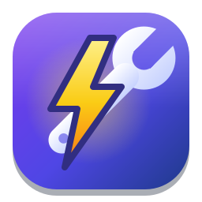

<div align="center">



# Voltkit

**English** · [Español](README.es.md) · [Deutsch](README.de.md) · [Français](README.fr.md) · [简体中文](README.zh-CN.md)

**Power tools for your Linux desktop.**
Screen OCR, a QR code scanner, a color picker, a screen ruler, an image &amp; video compressor, a text expander,
Smart Paste, Keep Awake, a batch file renamer, an image resizer, a zoom &amp; annotate tool, a hosts &amp; environment editor, a “what's using this?” finder, an app permissions
manager, a sleep troubleshooter, a system report, a shortcut detective and a GPU tuner, in one app.

[](https://github.com/arios4k/voltkit/releases/latest)
[](https://github.com/arios4k/voltkit/actions/workflows/ci.yml)
[](https://arios4k.github.io/voltkit/manual/)
[](LICENSE)
[](#install-ubuntu-debian-and-derivatives)
[](#install-fedora)
[](https://www.rust-lang.org)
[](https://paypal.me/AlexisRios)

<picture>
  <source media="(prefers-color-scheme: dark)" srcset="docs/screenshots/color-dark.png?v=0.11.0">
  
</picture>

</div>

## One app instead of eighteen

Getting these basics on Linux usually means hunting down a separate applet for each job,
each with its own look, settings and shortcuts. Voltkit puts them in one native GTK4 app with one set of
hotkeys:

| Instead of… | Voltkit gives you | Shortcut |
|---|---|---|
| nothing: there was no screen for it | **App Permissions**: change or forget the answers you gave apps asking for screenshots, the camera, your location and more | — |
| a separate image compressor, plus ffmpeg incantations | **Asset Compressor**: drop PNG, JPEG, WebP or MP4 files to strip metadata and shrink them | drag &amp; drop |
| a separate color picker | **Color Picker**: an eyedropper for any pixel, HEX/RGB/HSL, WCAG contrast check and history | <kbd>Super</kbd>+<kbd>Shift</kbd>+<kbd>C</kbd> |
| shell loops with `mv` or a separate renamer | **Batch Rename**: rename many files at once with search and replace, regular expressions and numbering, with a preview and undo | — |
| a separate image resizer | **Image Resizer**: resize many pictures at once, keeping their shape, without touching the originals | — |
| a separate GPU tuning tool, plus vendor utilities | **GPU Tuner**: monitor NVIDIA, AMD and Intel graphics cards and change power limits, fans and fan curves, temperature targets, clocks and voltage, with every change previewed and undone unless you confirm it | — |
| editing `/etc/hosts` and `~/.profile` in a terminal | **Hosts & Environment**: switch hosts entries on and off, and manage your session's environment variables | — |
| a shell extension to keep the screen on | **Keep Awake**: stop your computer from sleeping or locking for 30 minutes to 4 hours, or until you turn it off | — |
| a separate presentation pen | **Zoom & Annotate**: freeze the screen, zoom in and draw on it with a pen, arrows, boxes and text | <kbd>Super</kbd>+<kbd>Shift</kbd>+<kbd>Z</kbd> |
| a QR scanner on your phone or a QR website | **QR Code**: read a QR code anywhere on screen, or turn text, links and Wi-Fi details into one | <kbd>Super</kbd>+<kbd>Shift</kbd>+<kbd>Q</kbd> |
| a separate screen ruler, or screenshots and an image editor | **Screen Ruler**: freeze the screen and measure anything in pixels | <kbd>Super</kbd>+<kbd>Shift</kbd>+<kbd>R</kbd> |
| guessing why a keyboard shortcut does nothing | **Shortcut Detective**: press any shortcut to see what owns it, find clashes, pick a free combination and change it | — |
| online converters for JSON, tables and letter case | **Smart Paste**: paste the clipboard converted: tidy JSON, a spreadsheet table as Markdown, a link without tracking, text from a PDF without broken lines, or the text in a copied image | <kbd>Super</kbd>+<kbd>Shift</kbd>+<kbd>V</kbd> |
| a pile of terminal commands to answer “what hardware do I have?” | **System Report**: your hardware explained, with driver and drive-health checks and fixes, temperatures, firmware updates, memory upgrades, what changed since an update, and a report that's safe to share | — |
| a separate text expander | **Text Expansion**: a searchable snippet picker, plus optional typed triggers like `;date` | <kbd>Super</kbd>+<kbd>Shift</kbd>+<kbd>E</kbd> |
| a separate OCR app | **Text Extractor**: drag a box around any text on screen, even in videos and images, and it lands on your clipboard | <kbd>Super</kbd>+<kbd>Shift</kbd>+<kbd>T</kbd> |
| `lsof`, `fuser` and `ss` in a terminal | **What's Using This?**: see which apps keep a file, folder, drive or port busy, and close them | — |
| digging through system logs in a terminal | **Why Didn't It Sleep?**: see what keeps the computer awake, what woke it up, and how much battery it used asleep | — |

## Manual

**To learn how to use Voltkit, read the [Voltkit Manual](https://arios4k.github.io/voltkit/manual/).** It explains every tool step by step, with the keyboard shortcuts, command-line use, configuration and troubleshooting. It also opens from the app with **F1** or **Help & Manual** in the menu.

## Why Voltkit

- **Built for Wayland.** It uses the desktop's own portals for screenshots, the eyedropper and pasting, so
  there are no X11 hacks and no shell extensions.
- **Private by design.** Everything runs locally, with no network access and no telemetry.
- **Small and native.** One 4 MB binary (a 1.4 MB package), GTK4 + libadwaita, light and dark mode.
- **Scriptable.** Every feature is also a command, with man pages for all of them.
- **Self-checking.** `voltkit doctor` tells you exactly what's missing and the command to install it.
- **Signed packages.** Install and update through apt from a GPG-signed repository.
- **In your language.** English, Spanish, German, French and Simplified Chinese, following your system language.

Voltkit is developed and tested on GNOME (Zorin OS 18). It uses standard XDG portals, so KDE Plasma and other
desktops should work too; reports are welcome. More answers are in the [FAQ](https://arios4k.github.io/voltkit/manual/faq.html).

<sub>Screenshots taken on Zorin OS 18 with Voltkit’s light and dark palettes. Regenerate them with
`docs/screenshots/capture.sh` (pass `es`, `de`, `fr` or `zh_CN` to capture the translated app).</sub>

## Install (Ubuntu, Debian and derivatives)

For Ubuntu 24.04+, Debian 13+, Linux Mint 22, Zorin OS 18, Pop!_OS 24.04 and other derivatives
on 64-bit Intel/AMD:

```bash
sudo curl -fsSLo /usr/share/keyrings/voltkit-archive-keyring.gpg \
  https://arios4k.github.io/voltkit/voltkit-archive-keyring.gpg
echo "deb [signed-by=/usr/share/keyrings/voltkit-archive-keyring.gpg] https://arios4k.github.io/voltkit stable main" \
  | sudo tee /etc/apt/sources.list.d/voltkit.list
sudo apt update && sudo apt install voltkit
```

apt installs the required tools (Tesseract, wl-clipboard, the desktop portal) along with Voltkit, and
updates arrive with `sudo apt upgrade`.

Then open Voltkit from your apps: it sets up its background service and keyboard shortcuts by itself.
See [Install](https://arios4k.github.io/voltkit/manual/install.html) and [A tour of the app](https://arios4k.github.io/voltkit/manual/tour.html) in the manual for what to do next.

## Install (Fedora)

For Fedora 43 and newer on 64-bit Intel/AMD, from the [COPR repository](https://copr.fedorainfracloud.org/coprs/arios/voltkit/):

```bash
sudo dnf copr enable arios/voltkit
sudo dnf install voltkit
```

Then open Voltkit from your apps; it sets itself up the same way. Updates arrive with
`sudo dnf upgrade`.

## Install (from source)

Requirements: Rust 1.85+, GTK ≥ 4.14, libadwaita ≥ 1.5.

```bash
# Debian/Ubuntu
sudo apt install libgtk-4-dev libadwaita-1-dev
# Fedora
sudo dnf install gtk4-devel libadwaita-devel
# Arch
sudo pacman -S gtk4 libadwaita
```

```bash
cargo install --path .     # installs to ~/.cargo/bin/voltkit
voltkit
```

Install the binary before you set up shortcuts or autostart: both record the binary's path.

To add Voltkit to your app grid with its icon:

```bash
install -Dm644 data/icons/io.github.arios4k.Voltkit.svg ~/.local/share/icons/hicolor/scalable/apps/io.github.arios4k.Voltkit.svg
install -Dm644 data/icons/io.github.arios4k.Voltkit-symbolic.svg ~/.local/share/icons/hicolor/symbolic/apps/io.github.arios4k.Voltkit-symbolic.svg
sed "s|^Exec=voltkit|Exec=$HOME/.cargo/bin/voltkit|" data/io.github.arios4k.Voltkit.desktop > ~/.local/share/applications/io.github.arios4k.Voltkit.desktop
```

## Translations

Voltkit is translated into Spanish, German, French and Simplified Chinese. The text lives in ordinary gettext files in [`po/`](po/), which
are built into the binary, so there's nothing extra to install. To add a language or fix a translation, see
[`po/README.md`](po/README.md).

## Project layout

```
src/
  main.rs            CLI entry point (clap) → GUI when run with no subcommand
  i18n.rs            translations: built-in .po catalogs, the system language
  app.rs             GTK4 / libadwaita control center
  daemon.rs          background service: D-Bus API, portal shortcuts, autostart
  actions.rs         hotkey actions (OCR, eyedropper) with notifications
  shortcuts.rs       accelerator conversion + GNOME keybinding fallback
  picker.rs          snippet picker popup
  snippets_ui.rs     Text Expansion page: snippet list and editor
  qr_ui.rs           QR Code page
  ruler.rs           Screen Ruler (frozen-screenshot overlay)
  snapshot.rs        shared start-up of the tools that work on a frozen screenshot
  zoom.rs            Zoom & Annotate (zoom and draw on the frozen screen)
  rename_ui.rs       Batch Rename page: files, preview, rename and undo
  resize_ui.rs       Image Resizer page
  bulk_cli.rs        `voltkit rename` and `voltkit resize`
  guide_ui.rs        the shortcut cheat sheet window
  awake.rs           Keep Awake (Inhibit portal, held by the daemon)
  awake_ui.rs        Keep Awake page
  system_ui.rs       Hosts & Environment page
  usage_ui.rs        What's Using This? page
  permissions_ui.rs  App Permissions page
  sleep_ui.rs        Why Didn't It Sleep? page
  gpu_ui.rs          GPU Tuner page: readings, support report, controls
  gpu_cli.rs         `voltkit gpu`, the root helper and the background service
  sysreport_ui.rs    System Report page
  detective_ui.rs    Shortcut Detective page
  smartpaste_ui.rs   Smart Paste window and page
  expander.rs        typed triggers (evdev keyboard reading, uinput virtual keyboard)
  paste.rs           paste into the focused app, restoring the clipboard
  portal.rs          XDG portal calls (screenshot, PickColor) and notifications
  config.rs          TOML config with defaults
  system.rs          Wayland/X11 helpers: clipboard, tool discovery, process runner
  modules/
    ocr.rs           region capture + Tesseract
    color.rs         parsing, HSL, WCAG luminance & contrast
    compress.rs      format detection + per-format compression pipelines
    rename.rs        batch rename: plan, conflicts, two-step apply, undo journal
    resize.rs        image resizing with GdkPixbuf
    annotate.rs      the drawing model of Zoom & Annotate: marks, undo, zoom view
    guide.rs         the shortcut cheat sheet's groups and filter
    snippets.rs      snippet template engine
    qr.rs            QR code reading and making
    hosts.rs         /etc/hosts parsing that preserves everything it doesn't edit
    envvars.rs       session environment variables (environment.d)
    usage.rs         finds and closes the processes using a path or port (/proc)
    permissions.rs   the desktop portal's permission store
    sleep.rs         sleep blockers, sleep history (journal, UPower) and wake devices
    gpu.rs           GPU detection, sensors and what each card supports (NVIDIA, AMD, Intel)
    gpu_tune.rs      validated, transactional GPU changes, fan curves, startup guard
    nvml.rs          NVIDIA management library binding
    sysreport.rs     hardware, checks, drive health, sensors, firmware, snapshots, SMBIOS memory
    keybindings.rs   every GSettings shortcut: owners, clashes, free combinations, changes
    smartpaste.rs    Smart Paste's text conversions
  manpages.rs        man page generator (clap_mangen + hand-written sections)
  screenshots.rs     renders the README screenshots (hidden `screenshots` command)
po/                  translations (Spanish, German, French, Simplified Chinese) and update.py to refresh them
man/                 generated man pages (man/es, man/de, man/fr, man/zh_CN: translated)
packaging/apt/        APT repository builder and its landing page
docs/screenshots/    README screenshots and capture.sh to regenerate them
docs/ARCHITECTURE.md design notes and roadmap
```

## Contributing

```bash
cargo test
cargo clippy
python3 po/update.py --check   # translations up to date and complete
```

After changing a command or its help text, regenerate the man pages in [`man/`](man/) with `cargo run -- manpages man`; `cargo test` fails until you do.

See [docs/ARCHITECTURE.md](docs/ARCHITECTURE.md) for the D-Bus API and the roadmap. A settings screen is planned. Bug reports and testing on other desktops are
especially welcome.

## Releasing

1. Bump `version` in `Cargo.toml`, run `cargo run -- manpages man` and `python3 po/update.py`, and commit.
2. Tag and push: `git tag v0.2.0 && git push origin v0.2.0`.

The [Release workflow](.github/workflows/release.yml) builds the `.deb`, publishes a GitHub Release
with it, and rebuilds the signed APT repository on GitHub Pages. It signs with the key in the
`APT_SIGNING_KEY` secret (fingerprint `65E8 4B8D 114C 6147 9CCA 4DDC EC0F 6B66 E480 2360`). To build
the repository locally: `APT_KEY_ID=<fingerprint> packaging/apt/build-repo.sh target/debian site`.

## Author

Created by **Alexis Rios-Negron**.

<picture>
  <source media="(prefers-color-scheme: dark)" srcset="docs/screenshots/about-dark.png?v=0.11.0">
  
</picture>

## Support Voltkit

If Voltkit has been useful to you, please consider [making a donation of any amount](https://paypal.me/AlexisRios) to help keep the project running and support its continued development. Every contribution is appreciated.

The intention is to keep Voltkit free and available to everyone. Thank you for using it and for any support you can offer!

## License

MIT © Alexis Rios-Negron
