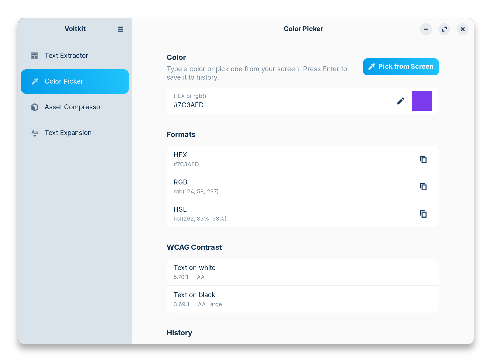
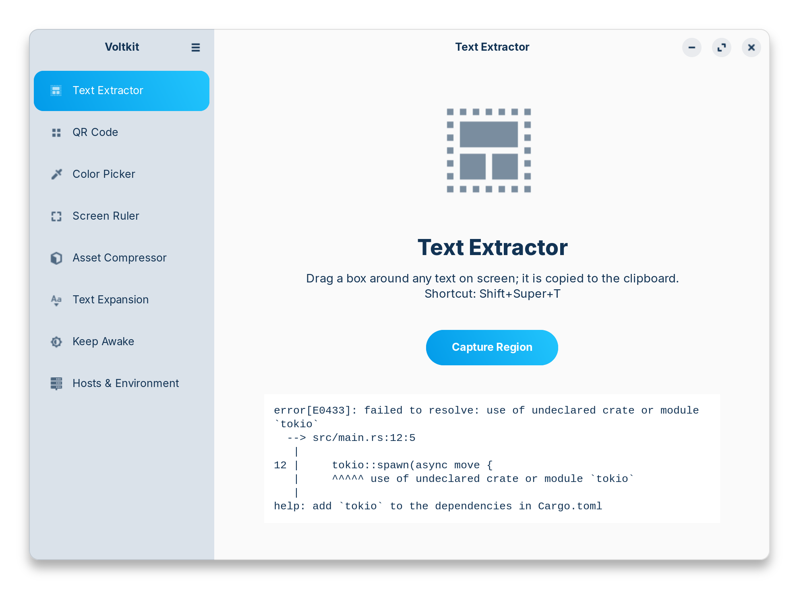
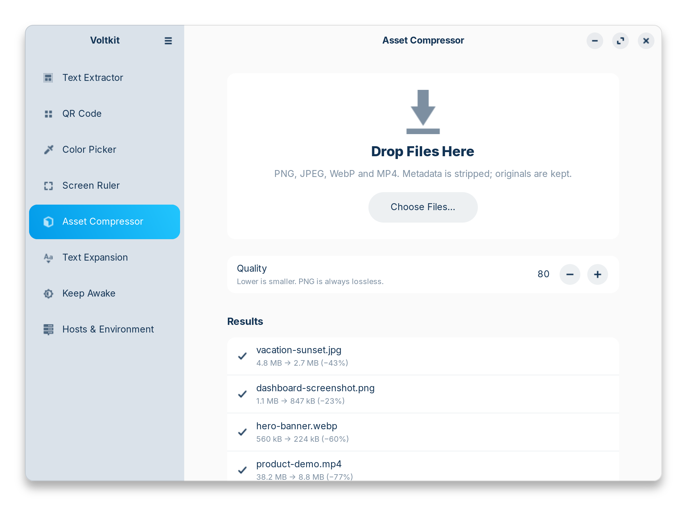
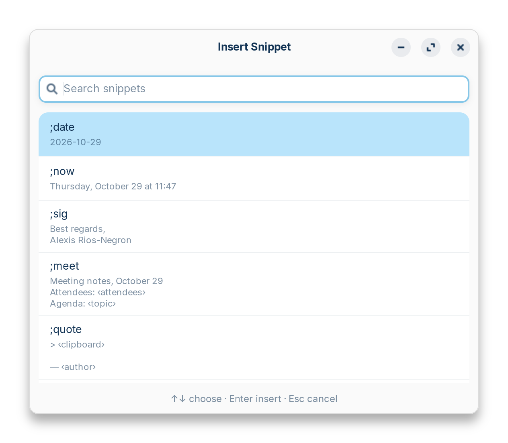
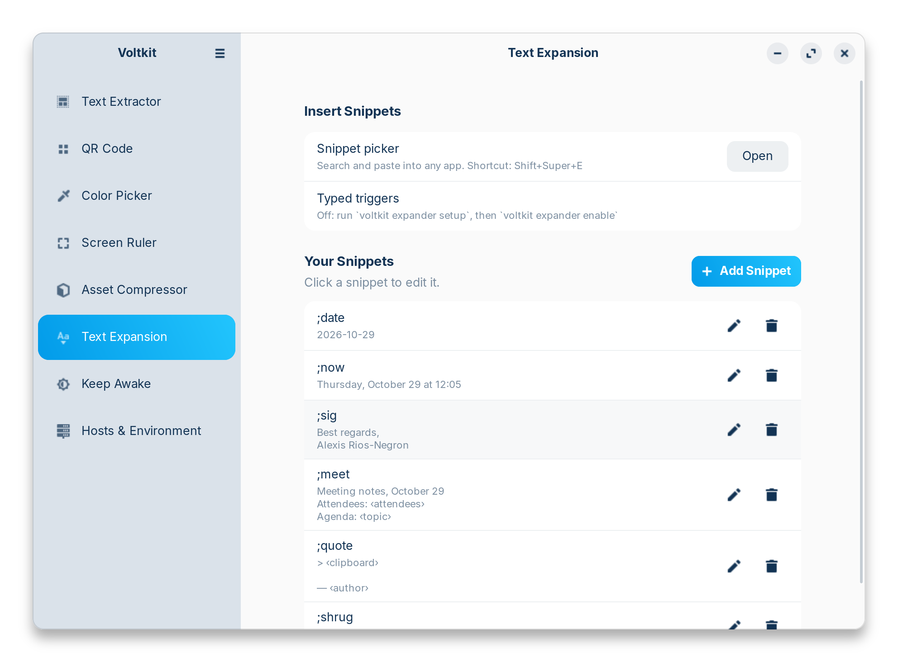
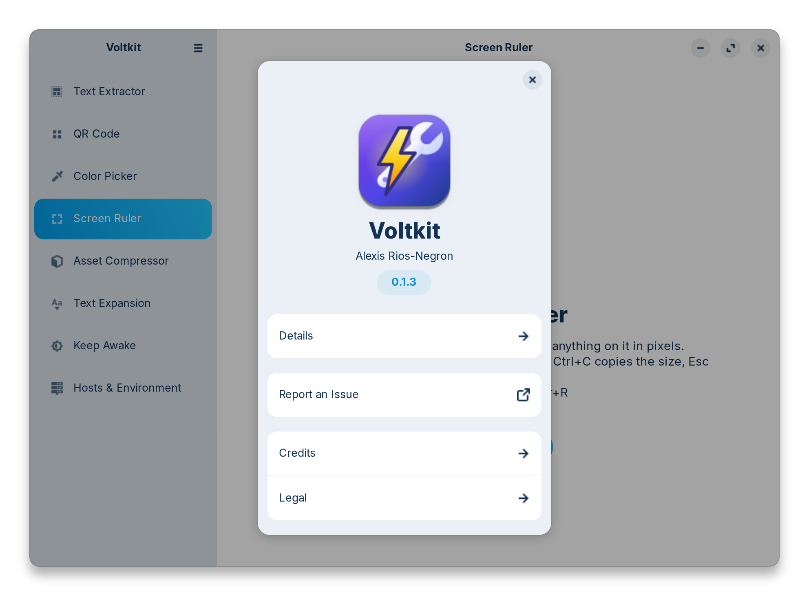

<div align="center">


# Voltkit

**Power tools for your Linux desktop.**
Screen OCR, a color picker, an image &amp; video compressor and a text expander, in one app.

[](https://github.com/arios4k/voltkit/releases/latest)
[](https://github.com/arios4k/voltkit/actions/workflows/ci.yml)
[](LICENSE)
[](#install-ubuntu-debian-and-derivatives)
[](https://www.rust-lang.org)

<picture>
  <source media="(prefers-color-scheme: dark)" srcset="docs/screenshots/color-dark.png">
  
</picture>

</div>

## One app instead of four

Getting PowerToys-style basics on Linux usually means hunting down a separate applet for each job,
each with its own look, settings and shortcuts. Voltkit puts them in one native GTK4 app with one set of
hotkeys:

| Instead of… | Voltkit gives you | Shortcut |
|---|---|---|
| a separate OCR app like NormCap | **Text Extractor**: drag a box around any text on screen, even in videos and images, and it lands on your clipboard | <kbd>Super</kbd>+<kbd>Shift</kbd>+<kbd>T</kbd> |
| a color picker like Eyedropper or Gcolor3 | **Color Picker**: an eyedropper for any pixel, HEX/RGB/HSL, WCAG contrast check and history | <kbd>Super</kbd>+<kbd>Shift</kbd>+<kbd>C</kbd> |
| an image compressor like Curtail, plus ffmpeg incantations | **Asset Compressor**: drop PNG, JPEG, WebP or MP4 files to strip metadata and shrink them | drag &amp; drop |
| a text expander like Espanso or AutoKey | **Text Expansion**: a searchable snippet picker, plus optional typed triggers like `;date` | <kbd>Super</kbd>+<kbd>Shift</kbd>+<kbd>E</kbd> |

## Features

### 🔍 Copy text from anything on screen

Error messages in a screenshot, code in a video tutorial, text in an image: press
<kbd>Super</kbd>+<kbd>Shift</kbd>+<kbd>T</kbd>, drag a box, and paste. Powered by Tesseract, with support for
[100+ languages](https://tesseract-ocr.github.io/tessdoc/Data-Files-in-different-versions.html).

<picture>
  <source media="(prefers-color-scheme: dark)" srcset="docs/screenshots/ocr-dark.png">
  
</picture>

### 🎨 Pick, convert and check colors

Grab any pixel with <kbd>Super</kbd>+<kbd>Shift</kbd>+<kbd>C</kbd> and the HEX code is already on your
clipboard. The color page converts between HEX, RGB and HSL, rates contrast against white and black by
WCAG standards (AA / AAA), and remembers your recent colors.

### 📦 Shrink images and videos in one drop

Drop files on the window or run `voltkit compress`. Voltkit strips location data and other metadata,
compresses with the best tool for each format, and writes `name.min.ext` next to the original, which
it never touches. In our tests: JPEG −43%, PNG −23% (lossless), WebP −60%, MP4 −77%.

<picture>
  <source media="(prefers-color-scheme: dark)" srcset="docs/screenshots/compress-dark.png">
  
</picture>

### ⌨️ Type less with snippets

Press <kbd>Super</kbd>+<kbd>Shift</kbd>+<kbd>E</kbd>, search, press Enter, and the snippet is pasted into
whatever app you were using. Snippets can include the date in any format, your clipboard, and
fill-in-the-blank fields. Prefer typing? Turn on typed triggers and `;sig` becomes your signature in any
app. Add, edit and delete snippets right in the app: Insert buttons add the date, time, clipboard or a
fill-in field, and a live preview shows exactly what will be pasted.

<picture>
  <source media="(prefers-color-scheme: dark)" srcset="docs/screenshots/picker-dark.png">
  
</picture>

<picture>
  <source media="(prefers-color-scheme: dark)" srcset="docs/screenshots/snippets-dark.png">
  
</picture>

## Why Voltkit

- **Built for Wayland.** It uses the desktop's own portals for screenshots, the eyedropper and pasting, so
  there are no X11 hacks and no shell extensions.
- **Private by design.** Everything runs locally, with no network access and no telemetry. Typed
  triggers keep only the last few characters in memory and never log or store what you type.
- **Small and native.** One 4 MB binary (a 1.4 MB package), GTK4 + libadwaita, light and dark mode.
- **Scriptable.** Every feature is also a command (`voltkit ocr`, `voltkit color '#3584e4'`,
  `voltkit compress *.jpg`), with man pages for all of them.
- **Self-checking.** `voltkit doctor` tells you exactly what's missing and the command to install it.
- **Signed packages.** Install and update through apt from a GPG-signed repository.

## FAQ

**Does it work on KDE, Sway or Hyprland?**
Voltkit is developed and tested on GNOME (Zorin OS 18). It uses standard XDG portals, so KDE Plasma
and other desktops should work, but they haven't been tested yet. Reports are welcome! On desktops
without the GlobalShortcuts portal, bind `voltkit trigger ocr|color|snippets` to keys yourself.

**Is it safe to turn on typed triggers?**
They're off by default. Wayland hides keystrokes between apps, so typed triggers need access to the
keyboard device, which you grant once with `voltkit expander setup`. The snippet picker works without
any of that.

**Why isn't there a Flatpak?**
It's on the roadmap. For now there's the apt repository for Ubuntu/Debian-based systems, and building
from source works anywhere with GTK 4.14+.

<sub>Screenshots taken on Zorin OS 18 with its ZorinBlue theme. Regenerate them with
`docs/screenshots/capture.sh`.</sub>

## Install (Ubuntu, Debian and derivatives)

For Ubuntu 24.04+, Debian 13+, Linux Mint 22, Zorin OS 18, Pop!_OS 24.04 and other derivatives
on 64-bit Intel/AMD:

```bash
sudo curl -fsSLo /usr/share/keyrings/voltkit-archive-keyring.gpg \
  https://arios4k.github.io/voltkit/voltkit-archive-keyring.gpg
echo "deb [signed-by=/usr/share/keyrings/voltkit-archive-keyring.gpg] https://arios4k.github.io/voltkit stable main" \
  | sudo tee /etc/apt/sources.list.d/voltkit.list
sudo apt update && sudo apt install voltkit
```

apt installs the required tools (Tesseract, wl-clipboard, the desktop portal) along with Voltkit, and
updates arrive with `sudo apt upgrade`. Then:

```bash
voltkit doctor                    # check everything is in place
voltkit shortcuts install         # GNOME: Super+Shift+T, C and E
voltkit daemon enable-autostart   # start the background service at login
```

PNG compression needs `oxipng`, which Ubuntu doesn't package: `cargo install oxipng`.

## Install (from source)

Requirements: Rust 1.85+, GTK ≥ 4.14, libadwaita ≥ 1.5.

```bash
# Debian/Ubuntu
sudo apt install libgtk-4-dev libadwaita-1-dev
# Fedora
sudo dnf install gtk4-devel libadwaita-devel
# Arch
sudo pacman -S gtk4 libadwaita
```

```bash
cargo install --path .     # installs to ~/.cargo/bin/voltkit
voltkit
```

Install the binary before you set up shortcuts or autostart: both record the binary's path.

To add Voltkit to your app grid with its icon:

```bash
install -Dm644 data/icons/io.github.arios4k.Voltkit.svg ~/.local/share/icons/hicolor/scalable/apps/io.github.arios4k.Voltkit.svg
install -Dm644 data/icons/io.github.arios4k.Voltkit-symbolic.svg ~/.local/share/icons/hicolor/symbolic/apps/io.github.arios4k.Voltkit-symbolic.svg
sed "s|^Exec=voltkit|Exec=$HOME/.cargo/bin/voltkit|" data/io.github.arios4k.Voltkit.desktop > ~/.local/share/applications/io.github.arios4k.Voltkit.desktop
```

## Background service & global shortcuts

```bash
voltkit daemon                    # run in the foreground
voltkit daemon enable-autostart   # start at every login
voltkit daemon status             # running? which shortcut backend?
voltkit daemon stop
```

The daemon owns `io.github.arios4k.Voltkit.Daemon` on the session bus, so only one runs at a time.
It binds the hotkeys from your config in one of these ways:

| Desktop | How the hotkeys are bound |
|---|---|
| GNOME 48+, KDE Plasma 5.27+, Hyprland (xdg-desktop-portal ≥ 1.19) | **GlobalShortcuts portal**: the desktop asks you to approve them once |
| Older GNOME (e.g. 46) and GNOME-based distros | `voltkit shortcuts install` adds them to *Settings → Keyboard → Custom Shortcuts* (`--dry-run` previews; `shortcuts remove` undoes) |
| Sway, river, others | Bind `voltkit trigger ocr` / `voltkit trigger color` in your compositor config |

`voltkit trigger <action>` (`ocr`, `color` or `snippets`) sends the action to the running daemon, or runs it directly if
no daemon is running. Results and errors appear as desktop notifications.

## Text expansion

**Managing snippets:** on the Text Expansion page, use **Add Snippet**, click a snippet to edit it, or
delete it (with Undo). Changes are saved to `~/.config/voltkit/config.toml` and reach typed triggers
immediately. If you edit that file by hand, run `voltkit daemon reload`.

**Snippet picker** (no setup): press `Super+Shift+E`, type to search, press Enter. Snippets with
`{arg:NAME}` parameters show a small form. The result is pasted into the app you were using, and
your clipboard is put back afterwards. The first paste asks for remote-desktop permission (that's
how Wayland lets an app press Ctrl+V for you), and the permission is remembered.

**Typed triggers** (opt-in): type `;date` in any app and it turns into `2026-10-27`. Wayland hides
keystrokes from other apps, so this needs a one-time root setup:

```bash
voltkit expander setup          # shows the commands and what they change
voltkit expander setup --apply  # runs them with sudo; then log out and back in
                                   # (restart instead if `loginctl` lingering is on)
voltkit expander enable
```

Setup adds you to the `input` group, which lets *any* program you run read keyboard input. Voltkit
keeps only the last few characters in memory and never logs or stores what you type. See
`man voltkit-expander` for details and how to undo it.

For terminals, which paste with Ctrl+Shift+V, set `paste_shortcut` in the `[expander]` config section.

### Runtime helpers

Voltkit calls standard tools when they are installed, so it adds no heavy dependencies of its own.
Check what's missing, with the install command for your distro, at any time:

```bash
voltkit doctor
```

The control center shows a banner when a feature needs attention.

| Feature | Tools |
|---|---|
| OCR | `tesseract` (+ language packs such as `tesseract-ocr-eng`) |
| Region capture, eyedropper | the desktop's Screenshot portal; region capture falls back to `grim`+`slurp`, `gnome-screenshot`, `spectacle` or `maim` |
| Clipboard (daemon, CLI) | `wl-clipboard` (Wayland) or `xclip` (X11). Without it, the result is still shown in a notification |
| Compression | `oxipng` (PNG), `jpegoptim` (JPEG), `cwebp` (WebP), `ffmpeg` (MP4) |

## Command line

Every module also works headless, so you can bind it to a shortcut in any desktop:

```bash
voltkit                       # open the control center
voltkit ocr --lang eng        # select a region → text on clipboard
voltkit pick-color            # eyedropper → HEX on clipboard
voltkit color '#3584e4'       # HEX / RGB / HSL + contrast vs white/black
voltkit compress *.png --quality 75
voltkit expand 'Hi {arg:who}, {date:%A}' --arg who=Sam
```

Full documentation is in the man pages: `man voltkit`, `man voltkit-expand`, and so on.

### Man pages

The pages in [`man/`](man/) are generated from the CLI definitions, so they always match
`--help`. Install them next to the binary, where `man` finds them automatically:

```bash
mkdir -p ~/.cargo/share/man/man1 && cp man/*.1 ~/.cargo/share/man/man1/
```

After changing a command or its help text, regenerate them; `cargo test` fails until you do:

```bash
cargo run -- manpages man
```

## Configuration

`~/.config/voltkit/config.toml`. Every key is optional; see
[`data/config.example.toml`](data/config.example.toml).

## Project layout

```
src/
  main.rs            CLI entry point (clap) → GUI when run with no subcommand
  app.rs             GTK4 / libadwaita control center
  daemon.rs          background service: D-Bus API, portal shortcuts, autostart
  actions.rs         hotkey actions (OCR, eyedropper) with notifications
  shortcuts.rs       accelerator conversion + GNOME keybinding fallback
  picker.rs          snippet picker popup
  snippets_ui.rs     Text Expansion page: snippet list and editor
  expander.rs        typed triggers (evdev keyboard reading, uinput virtual keyboard)
  paste.rs           paste into the focused app, restoring the clipboard
  portal.rs          XDG portal calls (screenshot, PickColor) and notifications
  config.rs          TOML config with defaults
  system.rs          Wayland/X11 helpers: clipboard, tool discovery, process runner
  modules/
    ocr.rs           region capture + Tesseract
    color.rs         parsing, HSL, WCAG luminance & contrast
    compress.rs      format detection + per-format compression pipelines
    snippets.rs      snippet template engine
  manpages.rs        man page generator (clap_mangen + hand-written sections)
  screenshots.rs     renders the README screenshots (hidden `screenshots` command)
man/                 generated man pages
packaging/apt/        APT repository builder and its landing page
docs/screenshots/    README screenshots and capture.sh to regenerate them
docs/ARCHITECTURE.md design notes and roadmap
```

## Contributing

```bash
cargo test
cargo clippy
```

See [docs/ARCHITECTURE.md](docs/ARCHITECTURE.md) for the D-Bus API and the roadmap. The
next big pieces are a Flatpak and a settings screen. Bug reports and testing on other desktops are
especially welcome.

## Releasing

1. Bump `version` in `Cargo.toml`, run `cargo run -- manpages man`, and commit.
2. Tag and push: `git tag v0.2.0 && git push origin v0.2.0`.

The [Release workflow](.github/workflows/release.yml) builds the `.deb`, publishes a GitHub Release
with it, and rebuilds the signed APT repository on GitHub Pages. It signs with the key in the
`APT_SIGNING_KEY` secret (fingerprint `65E8 4B8D 114C 6147 9CCA 4DDC EC0F 6B66 E480 2360`). To build
the repository locally: `APT_KEY_ID=<fingerprint> packaging/apt/build-repo.sh target/debian site`.

## Author

Created by **Alexis Rios-Negron**.

<picture>
  <source media="(prefers-color-scheme: dark)" srcset="docs/screenshots/about-dark.png">
  
</picture>

## License

MIT © Alexis Rios-Negron
