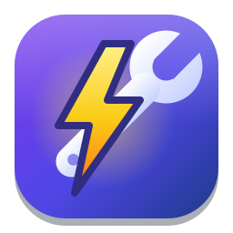

<div align="center">



# Voltkit

[English](README.md) · [Español](README.es.md) · [Deutsch](README.de.md) · [Français](README.fr.md) · **简体中文**

**为你的 Linux 桌面带来强大工具。**
屏幕 OCR、二维码扫描、取色器、屏幕标尺、图片和视频压缩器、文本扩展、智能粘贴、保持唤醒、hosts 与环境变量编辑器、
“是什么在占用它？”查找工具、应用权限管理器、休眠问题排查、系统报告、快捷键侦探和 GPU 调节器，集于一个应用。

[](https://github.com/arios4k/voltkit/releases/latest)
[](https://github.com/arios4k/voltkit/actions/workflows/ci.yml)
[](LICENSE)
[](#install-apt)
[](#install-fedora)
[](https://www.rust-lang.org)
[](https://paypal.me/AlexisRios)

<picture>
  <source media="(prefers-color-scheme: dark)" srcset="docs/screenshots/color-dark.png?v=0.11.0">
  
</picture>

</div>

> Voltkit 提供简体中文、英语、西班牙语、德语和法语，并会自动使用你系统的语言：应用、命令行和手册页（`man voltkit`）
> 都是如此。本页的截图为英文版。

## 一个应用，取代十八个

在 Linux 上要凑齐这些基础功能，往往得为每件事各找一个小工具，每个都有自己的外观、设置和快捷键。Voltkit 把它们
放进一个原生 GTK4 应用，共用一套快捷键：

| 以前你得用… | Voltkit 给你 | 快捷键 |
|---|---|---|
| 没有：根本没有对应的界面 | **应用权限**：更改或遗忘你对应用的截屏、摄像头、位置等请求所给出的回答 | — |
| 单独的图片压缩器，再加一堆 ffmpeg 咒语 | **资源压缩器**：拖入 PNG、JPEG、WebP 或 MP4 文件，即可删除元数据并缩小体积 | 拖放 |
| 单独的取色器 | **取色器**：可吸取任意像素，支持 HEX/RGB/HSL、WCAG 对比度检查和历史记录 | <kbd>Super</kbd>+<kbd>Shift</kbd>+<kbd>C</kbd> |
| 用 `mv` 写的 shell 循环或单独的重命名工具 | **批量重命名**：一次重命名许多文件，支持查找替换、正则表达式和编号，带预览和撤销 | — |
| 单独的图片缩放工具 | **图片缩放**：一次缩放许多图片，保持比例，不改动原文件 | — |
| 单独的 GPU 调节工具，外加各厂商的实用程序 | **GPU 调节器**：监控 NVIDIA、AMD 和 Intel 显卡，并更改功耗上限、风扇与风扇曲线、目标温度、频率和电压，每次更改都会先预览，未经确认即撤销 | — |
| 在终端里编辑 `/etc/hosts` 和 `~/.profile` | **Hosts 与环境变量**：开关 hosts 条目，并管理会话的环境变量 | — |
| 用来保持屏幕常亮的 shell 扩展 | **保持唤醒**：让电脑在 30 分钟到 4 小时内，或直到你关闭为止，不休眠、不锁屏 | — |
| 单独的演示画笔 | **缩放与批注**：冻结屏幕，放大并用画笔、箭头、方框和文字在上面绘制 | <kbd>Super</kbd>+<kbd>Shift</kbd>+<kbd>Z</kbd> |
| 手机上的扫码工具或二维码网站 | **二维码**：读取屏幕上任意位置的二维码，或把文字、链接和 Wi-Fi 信息生成二维码 | <kbd>Super</kbd>+<kbd>Shift</kbd>+<kbd>Q</kbd> |
| 单独的屏幕标尺，或截图加图片编辑器 | **屏幕标尺**：冻结屏幕，以像素为单位测量任何内容 | <kbd>Super</kbd>+<kbd>Shift</kbd>+<kbd>R</kbd> |
| 猜测某个键盘快捷键为什么没反应 | **快捷键侦探**：按下任意快捷键，查看它归谁所有、找出冲突、挑选空闲组合并修改 | — |
| 处理 JSON、表格和大小写的在线转换器 | **智能粘贴**：粘贴转换后的剪贴板内容：整理好的 JSON、转为 Markdown 的表格、去除跟踪参数的链接、去掉断行的 PDF 文字，或复制的图片中的文字 | <kbd>Super</kbd>+<kbd>Shift</kbd>+<kbd>V</kbd> |
| 一堆终端命令来回答“我有什么硬件？” | **系统报告**：用通俗的话解释你的硬件，包含对驱动和磁盘健康的检查与修复、温度、固件更新、内存升级、更新后有什么变化，以及可放心分享的报告 | — |
| 单独的文本扩展工具 | **文本扩展**：可搜索的片段选择器，外加可选的键入触发词，如 `;date` | <kbd>Super</kbd>+<kbd>Shift</kbd>+<kbd>E</kbd> |
| 单独的 OCR 应用 | **文字提取器**：在屏幕上的任意文字周围拖出方框，视频和图片中的也行，文字会直接进入剪贴板 | <kbd>Super</kbd>+<kbd>Shift</kbd>+<kbd>T</kbd> |
| 终端里的 `lsof`、`fuser` 和 `ss` | **是什么在占用它？**：查看哪些应用占用了文件、文件夹、磁盘或端口，并将其关闭 | — |
| 在终端里翻系统日志 | **为什么没有休眠？**：查看是什么让电脑保持唤醒、是什么把它唤醒，以及休眠时用了多少电量 | — |

## 功能

### 🛡️ 应用权限

当应用请求截屏、使用摄像头或麦克风，或获取你的位置时，桌面会记住你的回答。“应用权限”按应用列出它们：拨动开关即可更改，
或遗忘某个回答，让应用再次询问。

<picture>
  <source media="(prefers-color-scheme: dark)" srcset="docs/screenshots/permissions-dark.png?v=0.11.0">
  
</picture>

### 📦 资源压缩器

把文件拖到窗口上，或运行 `voltkit compress`。Voltkit 会删除位置数据和其他元数据，为每种格式选用最合适的工具压缩，
并在原文件旁边写入 `name.min.ext`，绝不会改动原文件。在我们的测试中：JPEG 减小 43%，PNG 减小 23%（无损），
WebP 减小 60%，MP4 减小 77%。

<picture>
  <source media="(prefers-color-scheme: dark)" srcset="docs/screenshots/compress-dark.png?v=0.11.0">
  
</picture>

### ✏️ 批量重命名

拖入文件或文件夹，说明要改什么，先看**预览**再动手：查找替换、带 `$1` 分组的正则表达式、用 `{n:3}` 编号、大小写，以及只改名称或只改扩展名。冲突（两个文件同名、名称已被占用）会先指出，一批文件要么**全部改名要么全都不改**，最近一批还能**撤销**。终端里同样可用：`voltkit rename *.jpg --find IMG --replace 假期 --apply`。

<picture>
  <source media="(prefers-color-scheme: dark)" srcset="docs/screenshots/rename-dark.png?v=0.11.0">
  
</picture>

### 🖼️ 图片缩放

添加图片，选择尺寸（最长边、百分比，或适应、填充、拉伸的宽高，也可点击“电子邮件或聊天”这类示例），然后点击**缩放**：副本会出现在原文件旁边，原文件不会被改动。照片会摆正，WebP 和 JPEG 质量可调，除非你允许，否则图片不会被放大。`voltkit resize photos/*.jpg --longest-side 1280`。

<picture>
  <source media="(prefers-color-scheme: dark)" srcset="docs/screenshots/resize-dark.png?v=0.11.0">
  
</picture>

### 🎨 取色器

按 <kbd>Super</kbd>+<kbd>Shift</kbd>+<kbd>C</kbd> 吸取任意像素，HEX 代码就已经在剪贴板里了。颜色页面可在 HEX、RGB 和 HSL
之间转换，按 WCAG 标准（AA / AAA）评定它与白色和黑色的对比度，并记住你最近的颜色。

<picture>
  <source media="(prefers-color-scheme: dark)" srcset="docs/screenshots/color-dark.png?v=0.11.0">
  
</picture>

### 🎛️ GPU 调节器

实时查看你的 NVIDIA、AMD 和 Intel 显卡及其历史曲线，并更改硬件允许的内容：功耗上限、固定风扇转速或风扇曲线、显卡要维持的温度、
频率偏移或频率上下限，以及电压。**这块显卡支持什么**会按驱动报告的情况列出每个控制项，并说明缺少某一项的原因以及怎样可能开启它
（比如隐藏了风扇的笔记本 GPU，或需要 `amdgpu.ppfeaturemask` 的 AMD 显卡）。更改会对照显卡自身的限制进行检查、先预览，再通过 root
辅助程序应用，并且**未经确认就会撤销**：关闭应用或应用崩溃同样会撤销。已保存的设置由后台服务在启动时应用，它会跳过一个始终没能启动完成的
配置，因此有问题的配置不会让你陷入循环。`voltkit gpu` 会在终端中输出同样的报告。

通过在图表上拖动点来编辑风扇曲线，并选择它们所依据的温度和所控制的风扇。把设置保存为会自动切换的**配置文件**：使用电池时、某个应用运行时、负载持续较高时，或显卡过热时。在游戏或基准测试运行时**录制一次会话**，并排比较两个配置文件：温度、功耗、耗电量和效率（每瓦有效频率；若录制了帧数，则是每瓦帧数）。`voltkit gpu check` 会把 Voltkit 的读数与 `nvidia-smi` 对比，并测量监控的开销。

在你的显卡上试过了吗？一份说明哪些可用、哪些不可用的[硬件报告](https://github.com/arios4k/voltkit/issues/new?template=gpu-hardware-report.yml)，是目前最有帮助的反馈。

应用更改是新功能，目前只用模拟硬件测试过；哪些可用、如何保证安全以及还有什么没做，请参阅 [docs/GPU_TUNER.md](docs/GPU_TUNER.md)。

<picture>
  <source media="(prefers-color-scheme: dark)" srcset="docs/screenshots/gpu-dark.png?v=0.11.0">
  
</picture>

<picture>
  <source media="(prefers-color-scheme: dark)" srcset="docs/screenshots/gpu-2-dark.png?v=0.11.0">
  
</picture>

<picture>
  <source media="(prefers-color-scheme: dark)" srcset="docs/screenshots/gpu-3-dark.png?v=0.11.0">
  
</picture>

<picture>
  <source media="(prefers-color-scheme: dark)" srcset="docs/screenshots/gpu-4-dark.png?v=0.11.0">
  
</picture>

<picture>
  <source media="(prefers-color-scheme: dark)" srcset="docs/screenshots/gpu-vf-dark.png?v=0.11.0">
  
</picture>

<sub>此截图使用的是虚构显卡的模拟数据。</sub>

### 📝 Hosts 与环境变量

开关 `/etc/hosts` 条目，为本地开发添加 `myapp.test → 127.0.0.1`，并为整个桌面会话设置 `EDITOR` 这样的环境变量或额外的
`PATH` 文件夹。系统条目受到保护，每次保存 hosts 都会保留备份。

<picture>
  <source media="(prefers-color-scheme: dark)" srcset="docs/screenshots/system-dark.png?v=0.11.0">
  
</picture>

### ☕ 保持唤醒

在看视频、做演示或下载？开启“保持唤醒” 30 分钟、几个小时，或直到你关闭，电脑就不会休眠或锁屏。关闭 Voltkit 后它
仍会继续，时间到后自动关闭。

<picture>
  <source media="(prefers-color-scheme: dark)" srcset="docs/screenshots/awake-dark.png?v=0.11.0">
  
</picture>

### 📷 二维码

按 <kbd>Super</kbd>+<kbd>Shift</kbd>+<kbd>Q</kbd>，在视频、幻灯片或网页中的二维码周围拖出方框：它的文字或链接就进入了剪贴板。
反过来，输入链接、文字或你的 Wi-Fi 信息，用手机扫描生成的二维码。可以复制为图像，或保存为 PNG 以便打印。还可以在
中间加上你自己的小标志：Voltkit 会回读二维码，确保它仍然可以扫描。

<picture>
  <source media="(prefers-color-scheme: dark)" srcset="docs/screenshots/qr-dark.png?v=0.11.0">
  
</picture>

### 📏 屏幕标尺

<kbd>Super</kbd>+<kbd>Shift</kbd>+<kbd>R</kbd> 会冻结屏幕。拖动即可按真实像素测量宽度和高度（按住 Shift 画直线），
按 Ctrl+C 复制尺寸。

<picture>
  <source media="(prefers-color-scheme: dark)" srcset="docs/screenshots/ruler-dark.png?v=0.11.0">
  
</picture>

### 🔍 缩放与批注

<kbd>Super</kbd>+<kbd>Shift</kbd>+<kbd>Z</kbd> 冻结屏幕。滚动缩放，拖动绘制，按住 Shift 画直线，Ctrl 画矩形，Tab 画椭圆，Ctrl+Shift 画箭头，按 T 输入文字，R/G/B/O/Y/P 选颜色，W/K 切换白板或黑板，Ctrl+C 或 Ctrl+S 复制或保存图片。保存的图片放在“图片/Voltkit”，或你在该工具页面选择的文件夹中（Ctrl+Shift+S 可把某张图片存到别处）。

<picture>
  <source media="(prefers-color-scheme: dark)" srcset="docs/screenshots/zoom-overlay-dark.png?v=0.11.0">
  
</picture>

### ⌨️ 快捷键侦探

按了快捷键却没反应，或者触发了别的东西？在**快捷键侦探**里按下它，就能看到所有使用它的操作：窗口管理器、GNOME Shell、
系统按键、你的自定义快捷键、shell 扩展以及 Voltkit 本身。冲突会为你列出，每个冲突都附带可切换的空闲组合，任何快捷键
都可以就地更改、关闭或重置。适用于 GNOME 以及与之相似的桌面（Cinnamon、Budgie、MATE）。

<picture>
  <source media="(prefers-color-scheme: dark)" srcset="docs/screenshots/shortcuts-dark.png?v=0.11.0">
  
</picture>

### 📋 智能粘贴

按 <kbd>Super</kbd>+<kbd>Shift</kbd>+<kbd>V</kbd> 代替 <kbd>Ctrl</kbd>+<kbd>V</kbd>，选择如何粘贴你复制的内容：整理或压缩的
JSON、表格区域转为 Markdown 表格或 CSV、去除跟踪参数的链接、去掉断行的 PDF 段落、带项目符号或编号的列表，或转为大写、
标题式大小写、snake_case 等格式的文字。复制了一张截图？可以直接粘贴其中的文字。只会提供适合你所复制内容的转换，
每种都带预览，并且剪贴板会保持原样。同样的转换也可用于脚本：`wl-paste | voltkit convert markdown-table`。

<picture>
  <source media="(prefers-color-scheme: dark)" srcset="docs/screenshots/smartpaste-dark.png?v=0.11.0">
  
</picture>

### 🖥️ 系统报告

不只是一份规格清单：**系统报告**会检查每一件硬件，并说明它意味着什么。显卡用的是正确的驱动吗（如果不是，附上修复的
确切命令）？磁盘健康吗，磨损了多少？处理器是否过热或在自行降速？有没有等待安装的 BIOS 或设备固件更新？还有多少个内存
插槽空闲，这台电脑最多能装多少内存？

Voltkit 还会每天保存一份硬件、驱动、内核和固件的快照，所以当更新后出了问题，**有什么变化**会准确显示哪里不一样。需要
求助时，**复制报告**会给你一份整洁的摘要，可用于论坛或错误报告，其中不含序列号、名称或网络地址。

<picture>
  <source media="(prefers-color-scheme: dark)" srcset="docs/screenshots/sysreport-dark.png?v=0.11.0">
  
</picture>

### ⌨️ 文本扩展

按 <kbd>Super</kbd>+<kbd>Shift</kbd>+<kbd>E</kbd>，搜索，按 Enter，片段就会粘贴到你正在使用的应用中。片段可以包含任意格式的
日期、你的剪贴板内容，以及填空字段。更喜欢直接键入？开启键入触发词，`;sig` 就会在任何应用中变成你的签名。可以直接在
应用里添加、编辑和删除片段：“插入”按钮可加入日期、时间、剪贴板或填空字段，实时预览会准确显示将要粘贴的内容。

<picture>
  <source media="(prefers-color-scheme: dark)" srcset="docs/screenshots/snippets-dark.png?v=0.11.0">
  
</picture>

<picture>
  <source media="(prefers-color-scheme: dark)" srcset="docs/screenshots/picker-dark.png?v=0.11.0">
  
</picture>

<picture>
  <source media="(prefers-color-scheme: dark)" srcset="docs/screenshots/snippet-editor-dark.png?v=0.11.0">
  
</picture>

### 🔍 文字提取器

会议幻灯片上的 Wi-Fi 密码、视频教程里的一条命令、截图中的一个错误：按
<kbd>Super</kbd>+<kbd>Shift</kbd>+<kbd>T</kbd>，拖出方框，然后粘贴。由 Tesseract 驱动，支持
[100 多种语言](https://tesseract-ocr.github.io/tessdoc/Data-Files-in-different-versions.html)。

<picture>
  <source media="(prefers-color-scheme: dark)" srcset="docs/screenshots/ocr-dark.png?v=0.11.0">
  
</picture>

### 🔎 是什么在占用它？

弹出 U 盘时提示“目标正忙”，启动开发服务器时提示“地址已被使用”：选择磁盘、文件、文件夹或端口，就能看到哪些应用占用了它，
以及它们打开了什么。一键即可关闭应用（会先礼貌地请求它退出，只有它不肯退出才使用“强制退出”），或者让**弹出**替你
关闭它们并弹出磁盘。系统本身的组成部分绝不会被提供关闭。

<picture>
  <source media="(prefers-color-scheme: dark)" srcset="docs/screenshots/using-dark.png?v=0.11.0">
  
</picture>

### 🌙 为什么没有休眠？

笔记本在包里发烫，或者早上电池就没电了？查看此刻是什么让电脑保持唤醒（某个应用、一段视频、“保持唤醒”、某项电源设置、
外接显示器），最近一周每次休眠的开始和结束原因以及耗电量，还有允许唤醒电脑的 USB 设备，并提供一个开关来停用那个总把
它唤醒的设备。

<picture>
  <source media="(prefers-color-scheme: dark)" srcset="docs/screenshots/sleep-dark.png?v=0.11.0">
  
</picture>

## 为什么选择 Voltkit

- **为 Wayland 而生。** 截屏、取色和粘贴都使用桌面自带的门户，因此没有 X11 的取巧手段，也不需要 shell 扩展。
- **默认保护隐私。** 一切都在本地运行，没有网络访问，也没有遥测。键入触发词只在内存中保留最后几个字符，绝不记录或
  存储你输入的内容。
- **小巧而原生。** 一个 4 MB 的可执行文件（1.4 MB 的安装包），GTK4 + libadwaita，支持浅色和深色模式。
- **可脚本化。** 每项功能同时也是一条命令（`voltkit ocr`、`voltkit color '#3584e4'`、`voltkit compress *.jpg`），
  并为它们都提供了手册页。
- **自我检查。** `voltkit doctor` 会准确告诉你缺少什么，以及安装它的命令。
- **签名的软件包。** 通过 apt 从 GPG 签名的软件源安装和更新。
- **使用你的语言。** 简体中文、英语、西班牙语、德语和法语，跟随你系统的语言。

## 常见问题

**能在 KDE、Sway 或 Hyprland 上用吗？**
Voltkit 在 GNOME（Zorin OS 18）上开发和测试。它使用标准的 XDG 门户，因此 KDE Plasma 和其他桌面应该也能运行，但还没有
测试过。欢迎反馈！在没有 GlobalShortcuts 门户的桌面上，请自行将 `voltkit trigger ocr|color|snippets` 绑定到按键。

**开启键入触发词安全吗？**
它们默认是关闭的。Wayland 会隐藏应用之间的按键，因此键入触发词需要键盘访问权限，开启时你用密码授权一次即可。Voltkit
只在内存中保留最后几个字符，绝不保存或发送你输入的内容。片段选择器不需要这些就能使用。

**如何更改语言？**
Voltkit 跟随你会话的语言（简体中文、英语、西班牙语、德语或法语）。如果只想让 Voltkit 试用另一种语言，请在终端中用
`LANGUAGE=en voltkit` 启动（也可以是 `es`、`de`、`fr`、`zh_CN`）。

<sub>截图在 Zorin OS 18 上使用 Voltkit 的浅色和深色配色拍摄。可用 `docs/screenshots/capture.sh` 重新生成
（或用 `docs/screenshots/capture.sh zh_CN` 生成中文版应用的截图；也支持 `es`、`de` 和 `fr`）。</sub>

<a id="install-apt"></a>

## 安装（Ubuntu、Debian 及其衍生版）

适用于 Ubuntu 24.04+、Debian 13+、Linux Mint 22、Zorin OS 18、Pop!_OS 24.04 及其他衍生版，64 位 Intel/AMD：

```bash
sudo curl -fsSLo /usr/share/keyrings/voltkit-archive-keyring.gpg \
  https://arios4k.github.io/voltkit/voltkit-archive-keyring.gpg
echo "deb [signed-by=/usr/share/keyrings/voltkit-archive-keyring.gpg] https://arios4k.github.io/voltkit stable main" \
  | sudo tee /etc/apt/sources.list.d/voltkit.list
sudo apt update && sudo apt install voltkit
```

apt 会在安装 Voltkit 的同时安装所需工具（Tesseract、wl-clipboard、桌面门户），之后的更新通过 `sudo apt upgrade` 获得。

然后从应用列表中打开 Voltkit。就这样：它会启动自己的后台服务（此后每次登录也会启动），并在 GNOME 上添加键盘快捷键。
`voltkit doctor` 会检查一切是否就绪。在任何地方键入 `;date` 之类的触发词是可选的：在“文本扩展”页面开启**键入触发词**
（只需输入一次密码，立即生效）。

<a id="install-fedora"></a>

## 安装（Fedora）

适用于 64 位 Intel/AMD 的 Fedora 43 及更高版本，来自 [COPR 软件源](https://copr.fedorainfracloud.org/coprs/arios/voltkit/)：

```bash
sudo dnf copr enable arios/voltkit
sudo dnf install voltkit
```

然后从应用列表中打开 Voltkit；它会以同样的方式完成自身设置。更新通过 `sudo dnf upgrade` 获得。

## 安装（从源码）

要求：Rust 1.85+、GTK ≥ 4.14、libadwaita ≥ 1.5。

```bash
# Debian/Ubuntu
sudo apt install libgtk-4-dev libadwaita-1-dev
# Fedora
sudo dnf install gtk4-devel libadwaita-devel
# Arch
sudo pacman -S gtk4 libadwaita
```

```bash
cargo install --path .     # 安装到 ~/.cargo/bin/voltkit
voltkit
```

请在设置快捷键或开机自启之前先安装可执行文件：两者都会记录该文件的路径。

要用图标把 Voltkit 添加到应用网格：

```bash
install -Dm644 data/icons/io.github.arios4k.Voltkit.svg ~/.local/share/icons/hicolor/scalable/apps/io.github.arios4k.Voltkit.svg
install -Dm644 data/icons/io.github.arios4k.Voltkit-symbolic.svg ~/.local/share/icons/hicolor/symbolic/apps/io.github.arios4k.Voltkit-symbolic.svg
sed "s|^Exec=voltkit|Exec=$HOME/.cargo/bin/voltkit|" data/io.github.arios4k.Voltkit.desktop > ~/.local/share/applications/io.github.arios4k.Voltkit.desktop
```

## 后台服务与全局快捷键

```bash
voltkit daemon                    # 在前台运行
voltkit daemon enable-autostart   # 每次登录时启动
voltkit daemon status             # 是否在运行？使用哪种快捷键后端？
voltkit daemon stop
```

守护进程在会话总线上拥有 `io.github.arios4k.Voltkit.Daemon`，因此同一时间只会运行一个。它通过以下方式之一绑定你配置中的
快捷键：

| 桌面 | 快捷键的绑定方式 |
|---|---|
| GNOME 48+、KDE Plasma 5.27+、Hyprland（xdg-desktop-portal ≥ 1.19） | **GlobalShortcuts 门户**：桌面会请你批准一次 |
| 较旧的 GNOME（如 46）及基于 GNOME 的发行版 | `voltkit shortcuts install` 会把它们添加到“设置 → 键盘 → 自定义快捷键”（`--dry-run` 预览；`shortcuts remove` 撤销） |
| Sway、river 及其他 | 在合成器配置中绑定 `voltkit trigger ocr` / `voltkit trigger color` |

`voltkit trigger <action>`（`ocr`、`color` 或 `snippets`）会把操作发送给正在运行的守护进程；如果没有守护进程在运行，则直接
执行。结果和错误会以桌面通知的形式出现。

## 文本扩展

**管理片段：** 在“文本扩展”页面，使用**添加片段**，点击某个片段进行编辑，或删除它（可撤销）。更改会保存到
`~/.config/voltkit/config.toml`，并立即对键入触发词生效。如果你手动编辑了该文件，请运行 `voltkit daemon reload`。

**片段选择器**（无需设置）：按 `Super+Shift+E`，输入进行搜索，按 Enter。带有 `{arg:NAME}` 参数的片段会显示一个小表单。
结果会粘贴到你正在使用的应用中，之后剪贴板会恢复原样。第一次粘贴会请求远程桌面权限（这是 Wayland 让应用代你按 Ctrl+V
的方式），该权限会被记住。

**键入触发词**（可选）：在任何应用中键入 `;date`，它就会变成 `2026-10-27`。在“文本扩展”页面开启**键入触发词**。Wayland
会对其他应用隐藏按键，所以第一次会要求输入密码以授予键盘访问权限，然后立即生效：无需终端，也无需注销。关闭它时，会提示
是否同时移除该访问权限。在终端里对应的是 `voltkit expander setup --apply` 和 `voltkit expander remove-access`。

键盘访问权限允许坐在电脑前的用户运行的程序读取键盘，而不仅仅是 Voltkit。Voltkit 只在内存中保留最后几个字符，绝不记录或
存储你输入的内容。详见 `man voltkit-expander`。

对于使用 Ctrl+Shift+V 粘贴的终端，请在配置的 `[expander]` 部分设置 `paste_shortcut`。

### 运行时辅助工具

Voltkit 会在已安装时调用标准工具，因此它自身不增加任何沉重的依赖。你可以随时检查缺少什么，并获得适合你发行版的安装命令：

```bash
voltkit doctor
```

当某项功能需要注意时，控制中心会显示横幅。

| 功能 | 工具 |
|---|---|
| OCR | `tesseract`（以及 `tesseract-ocr-eng` 之类的语言包） |
| 区域截取、取色 | 桌面的截图门户；区域截取可退而使用 `grim`+`slurp`、`gnome-screenshot`、`spectacle` 或 `maim` |
| 剪贴板（守护进程、命令行） | `wl-clipboard`（Wayland）或 `xclip`（X11）。没有它时，结果仍会显示在通知中 |
| 压缩 | PNG 为内置；`jpegoptim`（JPEG）、`cwebp`（WebP）、`ffmpeg`（MP4） |

## 命令行

每个模块也都能在无界面的情况下使用，因此你可以在任何桌面上把它绑定到快捷键：

```bash
voltkit                       # 打开控制中心
voltkit ocr --lang eng        # 选取区域 → 文字进入剪贴板
voltkit pick-color            # 取色 → HEX 进入剪贴板
voltkit color '#3584e4'       # HEX / RGB / HSL + 相对白色/黑色的对比度
voltkit compress *.png --quality 75
voltkit expand 'Hi {arg:who}, {date:%A}' --arg who=Sam
voltkit qr make https://example.com  # 在终端中显示二维码（或使用 --output code.png）
voltkit qr scan               # 读取屏幕上的二维码
voltkit ruler                 # 测量屏幕
voltkit awake 1h30m           # 让电脑保持唤醒（on / off / 不带参数则显示状态）
voltkit using /media/$USER/USB  # 是什么让这个磁盘处于占用状态？（或端口：voltkit using 3000）
voltkit sleep                 # 为什么没有休眠，以及是什么把它唤醒
voltkit report                # 这台电脑、它的检查项和最近的变化（--memory：插槽和升级）
voltkit shortcuts who super+v # 某个快捷键的作用（还有：shortcuts list、shortcuts clashes）
voltkit smart-paste           # 粘贴转换后的剪贴板内容
wl-paste | voltkit convert json  # 在脚本中使用智能粘贴的转换（voltkit convert 会列出它们）
```

完整文档在手册页中：`man voltkit`、`man voltkit-expand` 等等。

### 手册页

[`man/`](man/) 中的页面由命令行定义生成，因此始终与 `--help` 保持一致；翻译位于 `man/es/`、`man/de/`、`man/fr/` 和
`man/zh_CN/`。把它们安装到可执行文件旁边，`man` 就会自动找到：

```bash
mkdir -p ~/.cargo/share/man/man1 ~/.cargo/share/man/zh_CN/man1
cp man/*.1 ~/.cargo/share/man/man1/ && cp man/zh_CN/*.1 ~/.cargo/share/man/zh_CN/man1/
```

修改命令或其帮助文字之后，请重新生成它们；在你这样做之前，`cargo test` 会失败：

```bash
cargo run -- manpages man
```

## 配置

`~/.config/voltkit/config.toml`。所有键都是可选的；参见 [`data/config.example.toml`](data/config.example.toml)。

## 翻译

Voltkit 已翻译为西班牙语、德语、法语和简体中文。文字保存在 [`po/`](po/) 中的普通 gettext 文件里，并已内置到可执行文件中，
所以无需额外安装任何东西。要添加语言或修正翻译，请参阅 [`po/README.md`](po/README.md)。

## 项目结构

```
src/
  main.rs            命令行入口 (clap) → 不带子命令时进入图形界面
  i18n.rs            翻译：内置的 .po 目录、系统语言
  app.rs             GTK4 / libadwaita 控制中心
  daemon.rs          后台服务：D-Bus API、门户快捷键、开机自启
  actions.rs         快捷键操作（OCR、取色）及通知
  shortcuts.rs       快捷键转换 + GNOME 快捷键后备方案
  picker.rs          片段选择器弹窗
  snippets_ui.rs     文本扩展页面：片段列表和编辑器
  qr_ui.rs           二维码页面
  ruler.rs           屏幕标尺（冻结截图的覆盖层）
  awake.rs           保持唤醒（Inhibit 门户，由守护进程持有）
  awake_ui.rs        保持唤醒页面
  system_ui.rs       Hosts 与环境变量页面
  usage_ui.rs        “是什么在占用它？”页面
  permissions_ui.rs  应用权限页面
  sleep_ui.rs        “为什么没有休眠？”页面
  gpu_ui.rs          GPU 调节器页面：读数、支持情况报告、控制项
  gpu_cli.rs         `voltkit gpu`、root 辅助程序和后台服务
  sysreport_ui.rs    系统报告页面
  detective_ui.rs    快捷键侦探页面
  smartpaste_ui.rs   智能粘贴窗口和页面
  expander.rs        键入触发词（evdev 读取键盘，uinput 虚拟键盘）
  paste.rs           粘贴到当前焦点所在的应用，并恢复剪贴板
  portal.rs          XDG 门户调用（截图、PickColor）和通知
  config.rs          带默认值的 TOML 配置
  system.rs          Wayland/X11 辅助：剪贴板、工具发现、进程运行器
  modules/
    ocr.rs           区域截取 + Tesseract
    color.rs         解析、HSL、WCAG 亮度与对比度
    compress.rs      格式检测 + 各格式的压缩流程
    snippets.rs      片段模板引擎
    qr.rs            二维码读取与生成
    hosts.rs         解析 /etc/hosts，并保留所有它未编辑的内容
    envvars.rs       会话环境变量 (environment.d)
    usage.rs         查找并关闭占用某个路径或端口的进程 (/proc)
    permissions.rs   桌面门户的权限存储
    sleep.rs         休眠阻止项、休眠历史（日志、UPower）和唤醒设备
    gpu.rs           GPU 检测、传感器以及每块显卡支持什么（NVIDIA、AMD、Intel）
    gpu_tune.rs      经过验证、具事务性的 GPU 更改、风扇曲线、启动保护
    nvml.rs          NVIDIA 管理库的绑定
    sysreport.rs     硬件、检查项、磁盘健康、传感器、固件、快照、SMBIOS 内存
    keybindings.rs   所有 GSettings 快捷键：所有者、冲突、空闲组合、更改
    smartpaste.rs    智能粘贴的文本转换
  manpages.rs        手册页生成器（clap_mangen + 手写章节）
  screenshots.rs     生成 README 截图（隐藏的 `screenshots` 命令）
po/                  翻译（西班牙语、德语、法语、简体中文）以及用于更新它们的 update.py
man/                 生成的手册页（man/es、man/de、man/fr、man/zh_CN：已翻译）
packaging/apt/        APT 软件源构建器及其落地页
docs/screenshots/    README 截图以及用于重新生成它们的 capture.sh
docs/ARCHITECTURE.md 设计说明和路线图
```

## 参与贡献

```bash
cargo test
cargo clippy
python3 po/update.py --check   # 翻译是否最新且完整
```

D-Bus API 和路线图请参阅 [docs/ARCHITECTURE.md](docs/ARCHITECTURE.md)。接下来的重头戏是 设置界面。尤其欢迎
错误报告以及在其他桌面上的测试。

## 发布

1. 在 `Cargo.toml` 中提高 `version`，运行 `cargo run -- manpages man` 和 `python3 po/update.py`，然后提交。
2. 打标签并推送：`git tag v0.2.0 && git push origin v0.2.0`。

[发布工作流](.github/workflows/release.yml)会构建 `.deb`，用它发布一个 GitHub Release，并在 GitHub Pages 上重建已签名的
APT 软件源。它使用 `APT_SIGNING_KEY` 机密变量中的密钥签名（指纹 `65E8 4B8D 114C 6147 9CCA 4DDC EC0F 6B66 E480 2360`）。
要在本地构建软件源：`APT_KEY_ID=<指纹> packaging/apt/build-repo.sh target/debian site`。

## 作者

由 **Alexis Rios-Negron** 创建。

<picture>
  <source media="(prefers-color-scheme: dark)" srcset="docs/screenshots/about-dark.png?v=0.11.0">
  
</picture>

## 支持 Voltkit

如果 Voltkit 对你有帮助，欢迎[捐赠任意金额](https://paypal.me/AlexisRios)，帮助项目持续运行和开发。每一份支持都值得感谢。

我们希望 Voltkit 始终免费，让每个人都能使用。感谢你的使用，也感谢你给予的任何支持！

## 许可证

MIT © Alexis Rios-Negron
